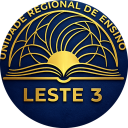
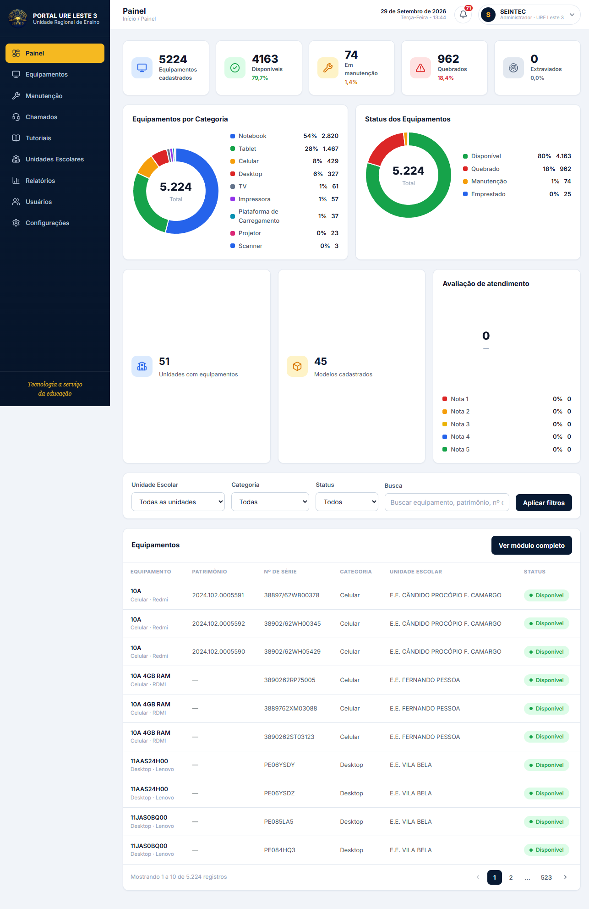
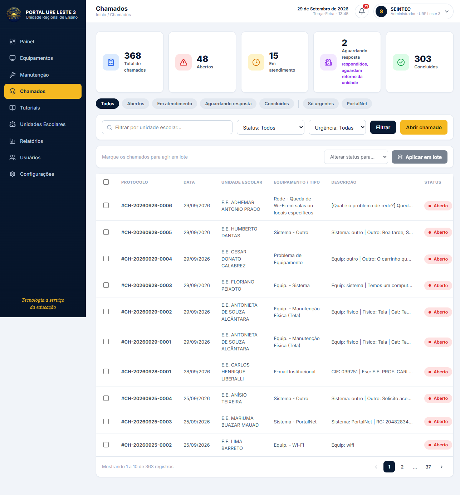
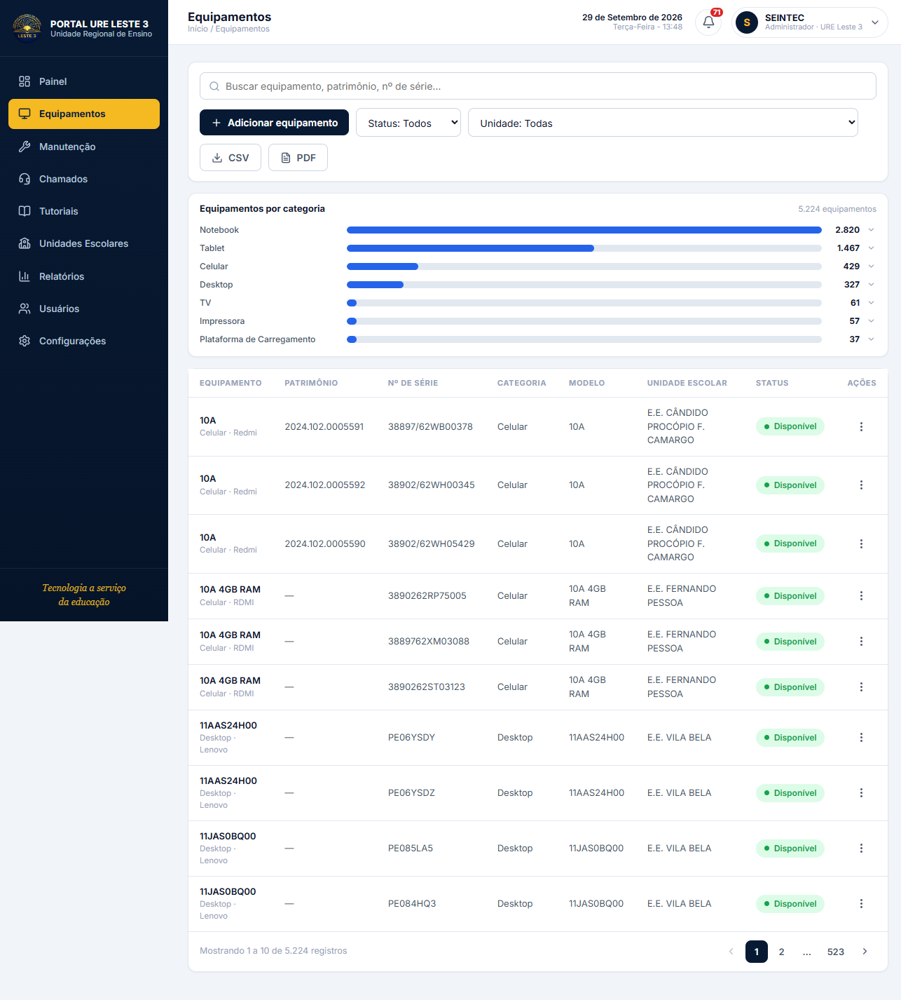
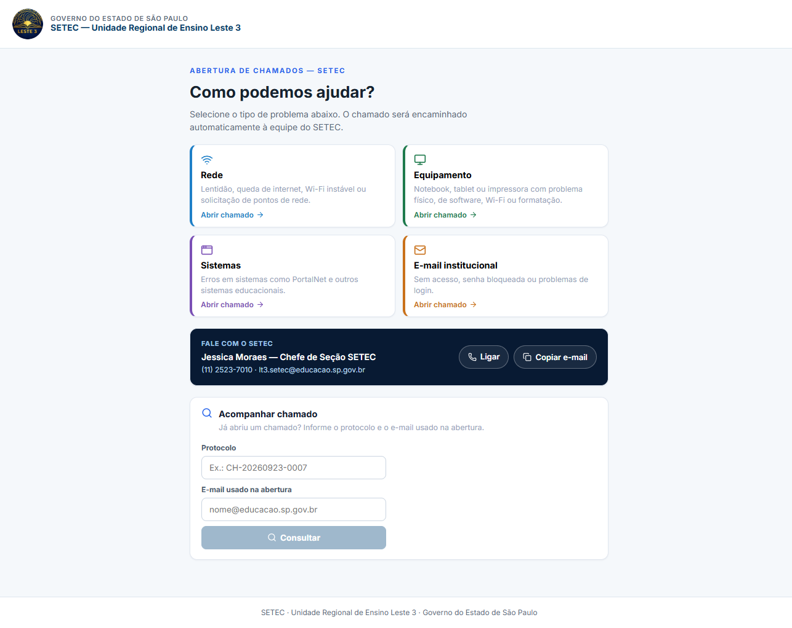
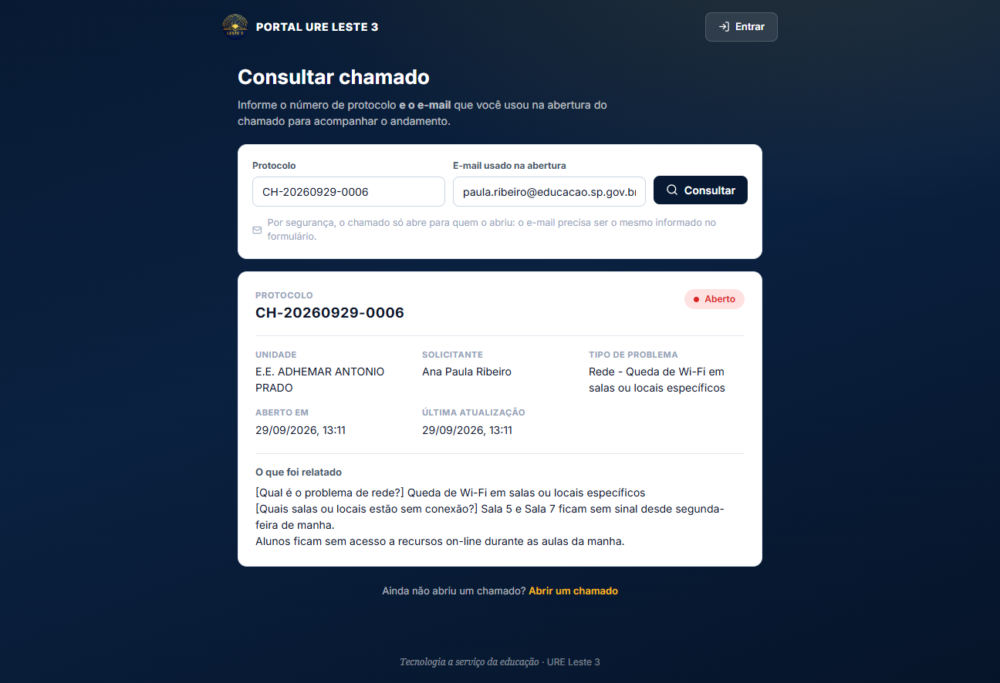
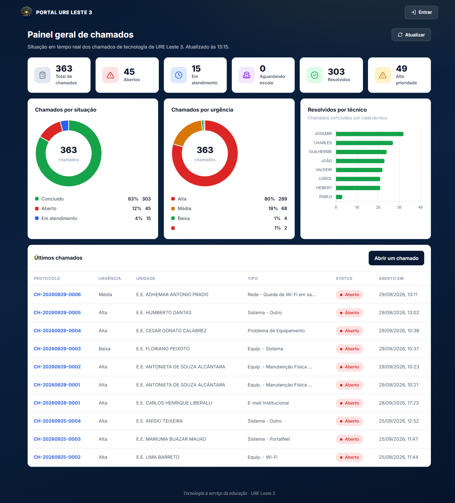
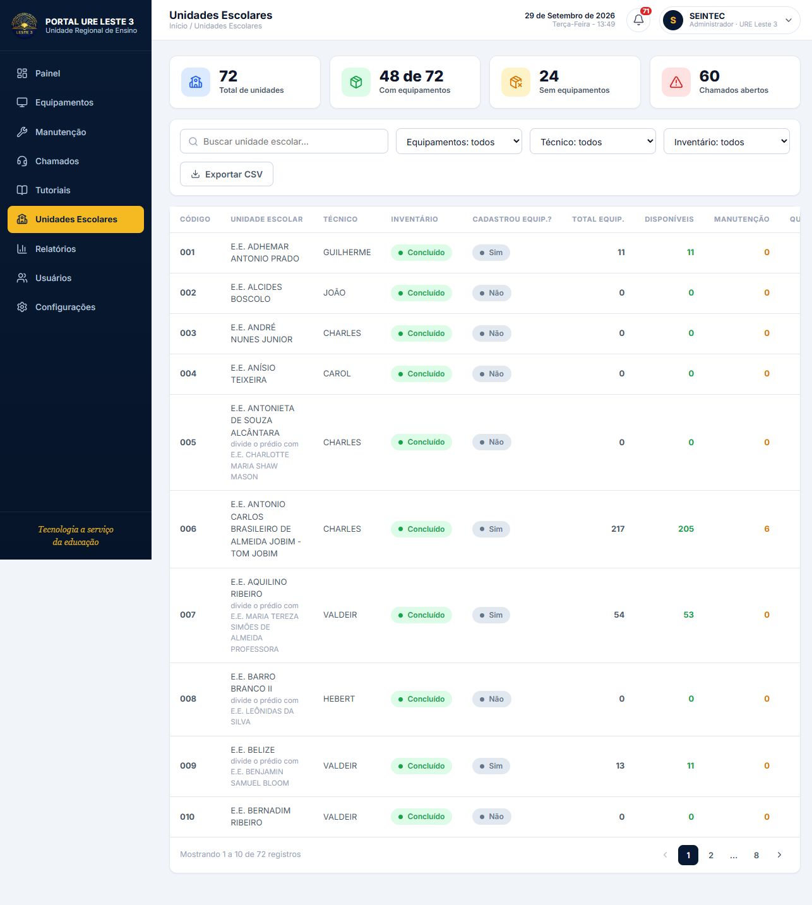
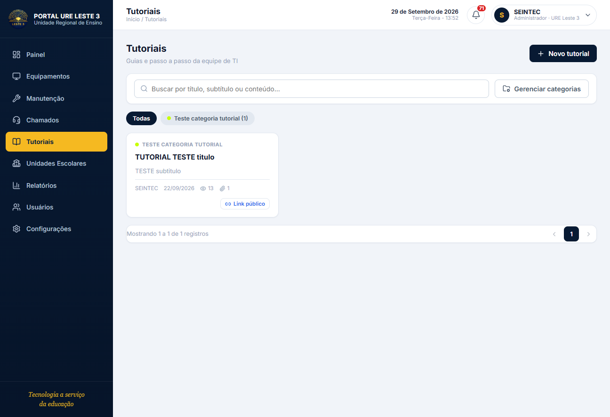
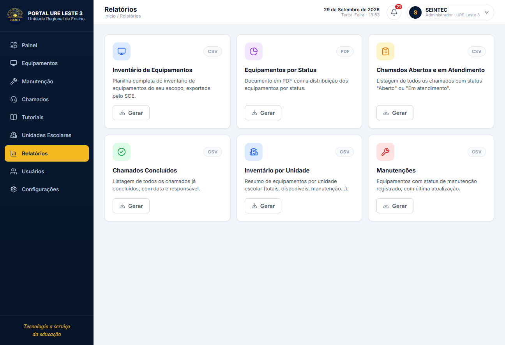

<p align="center"></p>

# Portal URE Leste 3

> **Portal unificado** da Unidade Regional de Ensino Leste 3 (SETEC / Governo do
> Estado de São Paulo) — chamados de suporte técnico e inventário de equipamentos
> em uma única interface.

[](https://vuejs.org)
[](https://www.typescriptlang.org)
[](https://vitejs.dev)
[](https://pinia.vuejs.org)
[](#)

[](./docs/06-backends-e-endpoints.md)
[](./docs/06-backends-e-endpoints.md)
[](./docs/14-monitor-de-cameras-dvr.md)

---

## O sistema em ação

| Painel da matriz | Chamados | Equipamentos |
|---|---|---|
|  |  |  |

| Abertura de chamado (público) | Consulta por protocolo | Painel geral (transparência) |
|---|---|---|
|  |  |  |
| Unidades escolares | Tutoriais | Relatorios |
|  |  |  |

> Mais de **80 prints reais** do sistema rodando em [`docs/screenshots/`](./docs/screenshots/).

---

## Funcionalidades

- **Chamados de suporte** — abertura pública por protocolo, fluxo completo de
 atendimento (encaminhar → aceitar → registrar → concluir → conferir/contestar →
 resolver/reabrir), mensagens e atividades.
- **Inventário de equipamentos** — cadastro, manutenção, empréstimos, catálogo,
 auditoria; regra MÃE/FILHA para escolas que compartilham prédio.
- **Monitor de câmeras DVR** — status online/offline dos DVRs das escolas,
 importação de lista, health-check.
- **Chat IA (CaféIA)** — assistente que consulta chamados e equipamentos,
 consulta agenda e solicita ponto (ADMIN).
- **Ponto** — registro com geolocalização, resumo do dia, férias, WhatsApp.
- **Agenda** — atribuições de técnicos por dia, cores por técnico.
- **Links de internet** — cadastro e relatório por unidade.
- **Tutoriais** — comentários e curtidas.
- **Avaliação de atendimento** — notas por chamado resolvido.
- **Relatórios** e painéis públicos de transparência.

---

## Stack

`Vue 3` · `TypeScript` · `Vite` · `Pinia` · `Vue Router` · `Chart.js` · `axios` ·
`Lucide` · `Playwright`

---

## Arquitetura

O portal conversa com **três backends**:

| Serviço | Porta | Repositório | Papel |
|---|---|---|---|
|  Chamados | `10000` | `~/Desktop/chamados` | Identidade (JWT), chamados, usuários, escolas, notificações, tutoriais, formulário, encaminhamento, avaliações, IA |
|  SCE | `3000` | `~/Desktop/sce` | Inventário de equipamentos, manutenção, empréstimos, catálogo, auditoria (mesmo JWT via SSO) |
| Monitor DVR | `4000` | `monitor/` | Ping dos DVRs das escolas, importação de lista (mesmo JWT via SSO) |

**Documentação dos backends (caminhos locais):** `~/Desktop/chamados/backend/docs/` · `~/Desktop/sce/docs/` · `./monitor/docs/`.

Um único login: o `accessToken` fica **só em memória** e o `refreshToken` viaja em
cookie `httpOnly`.

---

## Rodando local

```bash
npm install
Copy-Item .env.example .env   # Windows
npm run dev           # http://localhost:5173
```

`.env`:

```bash
VITE_API_CHAMADOS_URL=http://localhost:10000/api
VITE_API_SCE_URL=http://localhost:3000/api
VITE_API_MONITOR_URL=http://localhost:4000
```

> No Windows, para subir qualquer um dos três processos use
> `dev-restart -Port <PORTA> -Dir <DIR>` — veja
> [Build, deploy e ambientes](./docs/10-build-deploy-ambientes.md).

---

## Scripts

```bash
npm run dev     # servidor de desenvolvimento (HMR)
npm run build    # vue-tsc (tipos) + build de produção
npm run preview   # serve o dist/ localmente
npm run test:e2e   # Playwright
```

---

## Documentação

Documentação técnica completa em [`docs/`](./docs/README.md) — 22 capítulos e
80+ prints reais. Comece por:

- [01 · Visão geral](./docs/01-visao-geral.md)
- [02 · Arquitetura](./docs/02-arquitetura.md)
- [09 · Tratamento de erros](./docs/09-tratamento-de-erros.md) 
- [14 · Monitor de câmeras DVR](./docs/14-monitor-de-cameras-dvr.md)
- [19 · Chat IA](./docs/19-chat-ia.md)

Backup dos docs antigos em [`docs_backup/`](./docs_backup/).

---

## Papéis

`ADMIN` · `TECNICO` · `GESTOR` · `VISUALIZADOR` — mais o papel de unidade
`MAE`/`FILHA` (escolas que compartilham o mesmo prédio).

Público (sem login): abrir chamado, consultar por protocolo + e-mail, elogiar,
sugerir, ver painéis de transparência e tutoriais por link.


---

## Desenvolvido por

**Pablo Nascimento**

[](https://github.com/qzsousa) [](https://www.linkedin.com/in/pablo-nascimento-3bb92234a/)
