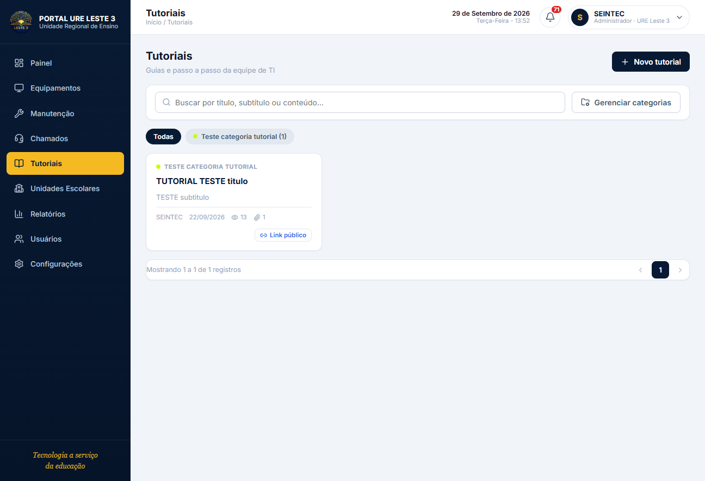

# 16 · Tutoriais — comentários e curtidas

Área de **comentários e curtidas (likes)** nas páginas de tutorial, assim como
em redes sociais: quem lê pode curtir, comentar e responder outros comentários.

## Resumo em 30 segundos

- Cada **usuário** pode **curtir** um **tutorial** uma única vez. Clicar de
  novo remove a curtida.
- Um tutorial pode ter **vários comentários**, feitos por usuários autenticados.
- Um comentário pode **responder** a outro, formando uma conversa aninhada.
- Um comentário também pode receber **curtidas**, uma por usuário.
- Excluir um comentário pai remove suas respostas automaticamente.

## Onde aparece no portal

Na tela de detalhe de um tutorial (`/tutoriais/:id`), logo após o conteúdo e
os anexos:

- Botão **"Curtir tutorial"** com contador.
- Área de **comentários** com campo de texto para publicar.
- Em cada comentário: contador de curtidas, botão **Responder** (abre um
  campo, pode ser cancelado) e **Excluir** (apenas o autor ou um ADMIN).
- As respostas ficam agrupadas embaixo do comentário principal.

> A captura acima é a listagem de tutoriais. A interação de curtir/comentar/
> responder está na **tela de detalhe** (`/tutoriais/:id`), entregue nesta
> mesma atualização. Prints com dados reais serão atualizados após a próxima
> publicação, já que o ambiente local não tem banco de dados para gerar exemplos.

## Como funciona por baixo (enxuto)

- **Curtida de tutorial** — cada usuário só pode ter uma por tutorial; a
  duplicação é bloqueada pelo próprio banco.
- **Comentário** — guarda o texto, o autor e a data. Se o usuário for removido
  do sistema, o comentário continua (com o nome preservado) para não perder
  o histórico.
- **Resposta** — um comentário pode apontar para outro (`parentId`); ao
  excluir o comentário pai, as respostas somem junto.
- **Curtida de comentário** — mesma regra de "uma por usuário".

Os contadores (quantas curtidas, quantos comentários) não são guardados em
coluna fixa: são contados quando a página é aberta, mantendo sempre o valor
correto.

## O que foi entregue

- Backend: endpoints de curtir/descurtir tutorial e comentário, listar e
  publicar comentários (inclusive respostas) e excluir.
- Portal: seção de interações na tela de detalhe do tutorial, com curtir,
  comentar, responder e excluir.
- Base de dados: tabelas e regras de integridade (migração
  `20261013170000_add_comentarios_likes_tutoriais`).
- Documentação: este arquivo.
