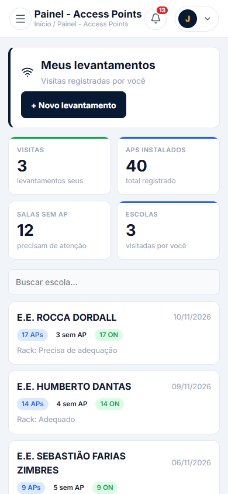
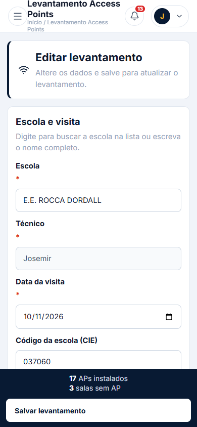

# Levantamento AP's — Dashboard do técnico

Acesso: menu **Escolas → Painel AP's** (perfil TÉCNICO).

## Visão geral
- KPIs simples: visitas, APs instalados, salas sem AP, escolas visitadas.
- Lista de levantamentos do próprio técnico em cards (mobile-first).
- Busca por escola.

## Detalhes e edição
1. Toque em um card para abrir o modal de detalhes.
2. Toque em **Editar levantamento** para abrir o formulário já preenchido.
3. Adicione/remova APs ou salas sem AP e altere campos.
4. Toque em **Salvar levantamento** para atualizar; retorna ao dashboard.

## Capturas

