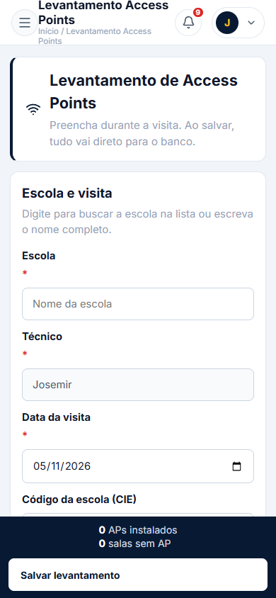
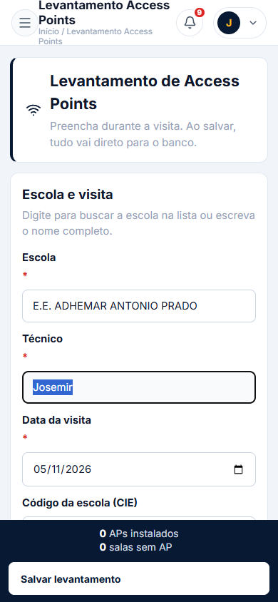
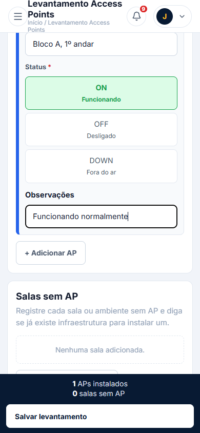
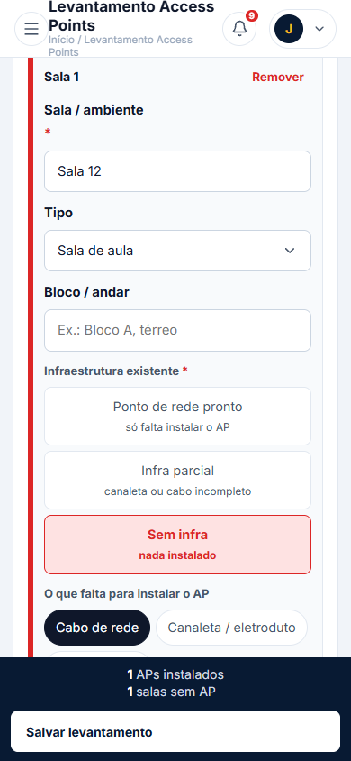
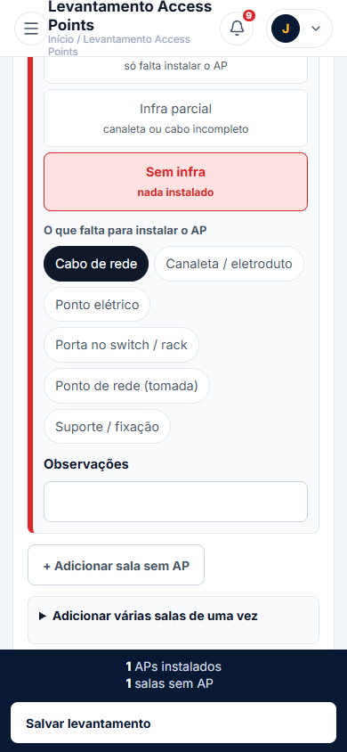
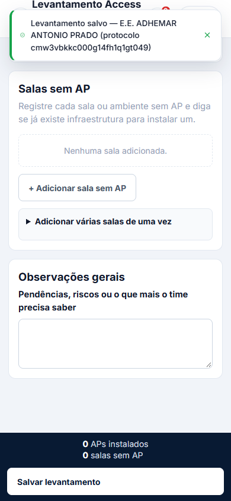

# Manual do Técnico — Levantamento de Access Points (AP's)

## Introdução

Este manual explica, passo a passo, como preencher o formulário **Levantamento de Access Points** no Portal URE Leste 3 durante a visita à escola. O registro é salvo no banco e ajuda a equipe a saber onde há AP instalado e onde falta infraestrutura.

## Pré-requisitos

- Ter **login de técnico** no portal.
- Estar conectado à internet no celular.
- Abrir o menu lateral, entrar em **Equipamentos** e tocar em **Levantamento AP's**.
- Usar o celular em **retrato** (em pé).

---

## Passo a passo

### 1. Abrir o formulário

Toque no menu (☰) se o menu estiver fechado, depois em **Equipamentos → Levantamento AP's**. A tela inicial mostra todas as seções do levantamento.

*Figura 1 — Tela inicial do formulário.*

**Dica no celular:** se o menu cobrir a tela, toque em **Abrir menu** novamente para fechá-lo.

---

### 2. Preencher escola e dados da visita

1. Toque em **Escola** e selecione a escola na lista (você pode digitar parte do nome).
2. O **Código da escola (CIE)** é preenchido automaticamente.
3. Confira o **Técnico** (preenchido com seu nome, somente leitura).
4. Ajuste a **Data da visita**, se necessário.
5. Informe o **Total de salas** da escola.
6. Escolha a **Condição do Rack Intragov** (Adequado / Precisa de adequação / Inexistente).

*Figura 2 — Escola selecionada com CIE preenchido.*

**Dica:** campos com `*` são obrigatórios.

---

### 3. Registrar os AP's instalados

1. Toque em **+ Adicionar AP** para criar um cartão por AP.
2. Preencha:
   - **Nº do AP** (etiqueta ou patrimônio);
   - **Localização** (onde o AP está);
   - **Bloco / andar**;
   - **Status** (ON, OFF ou DOWN);
   - **Observações** (opcional).
3. Repita para cada AP.
4. Se errar, toque em **Remover** no cartão.

*Figura 3 — AP instalado com status ON.*

**Importante:** o número do AP não pode se repetir no mesmo levantamento.

---

### 4. Registrar salas sem AP

1. Toque em **+ Adicionar sala sem AP** para cada sala/ambiente sem AP.
2. Preencha:
   - **Sala / ambiente**;
   - **Tipo** (sala de aula, biblioteca, etc.);
   - **Bloco / andar**;
   - **Infraestrutura existente** (Ponto de rede pronto / Infra parcial / Sem infra);
   - Se não for "Ponto de rede pronto", marque os chips do que falta (cabo, canaleta, ponto elétrico, etc.).
3. Para várias salas iguais, use **Adicionar várias salas de uma vez**: digite uma sala por linha, escolha a infraestrutura e toque em **Adicionar essas salas**.

*Figura 4 — Sala sem AP com status "Sem infra".*

---

### 5. Revisar e salvar

A barra inferior mostra os contadores de **APs instalados** e **salas sem AP**. Revise os dados e toque em **Salvar levantamento**.

*Figura 5 — Contadores e botão de salvar.*

---

### 6. Após salvar

Ao salvar, aparece uma mensagem de sucesso e o formulário é reiniciado para um novo levantamento. Se precisar registrar outra escola, comece de novo pelo passo 2.

*Figura 6 — Confirmação de salvamento.*

---

## Rascunho automático

O formulário salva um rascunho no navegador automaticamente. Se você fechar e abrir de novo, aparece um banner com duas opções:

- **Continuar rascunho** — recupera o que foi digitado.
- **Descartar** — apaga o rascunho e começa do zero.

---

## Erros comuns e como resolver

- **Campos em vermelho com "Campo obrigatório":** preencha todos os campos marcados com `*`.
- **"Informe o número do AP":** todo AP precisa de número.
- **"Escolha o status":** selecione ON, OFF ou DOWN em cada AP.
- **"Número repetido neste levantamento":** dois APs não podem ter o mesmo número; corrija ou remova o duplicado.
- **"Informe a sala":** toda sala sem AP precisa de nome.
- **"Escolha a infraestrutura existente":** selecione uma das três opções em cada sala sem AP.
- **Botão de salvar desabilitado ou nada acontece:** verifique a internet e tente novamente.
- **Banner de rascunho inesperado:** use **Descartar** se não quiser recuperar.

---

## Checklist final antes de salvar

- [ ] Escola selecionada.
- [ ] Técnico preenchido.
- [ ] Data da visita correta.
- [ ] Total de salas informado.
- [ ] Cada AP tem número, localização e status.
- [ ] Nenhum número de AP repetido.
- [ ] Cada sala sem AP tem nome e infraestrutura.
- [ ] Chips de "o que falta" marcados quando necessário.
- [ ] Contadores da barra inferior conferem com a realidade.
- [ ] Observações gerais preenchidas, se houver pendências.
